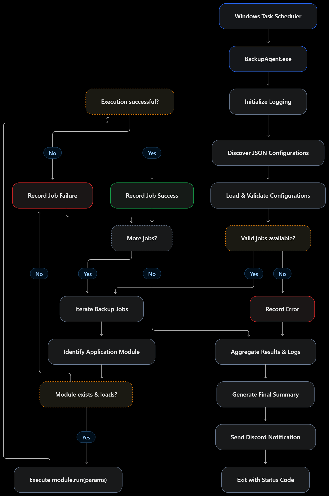
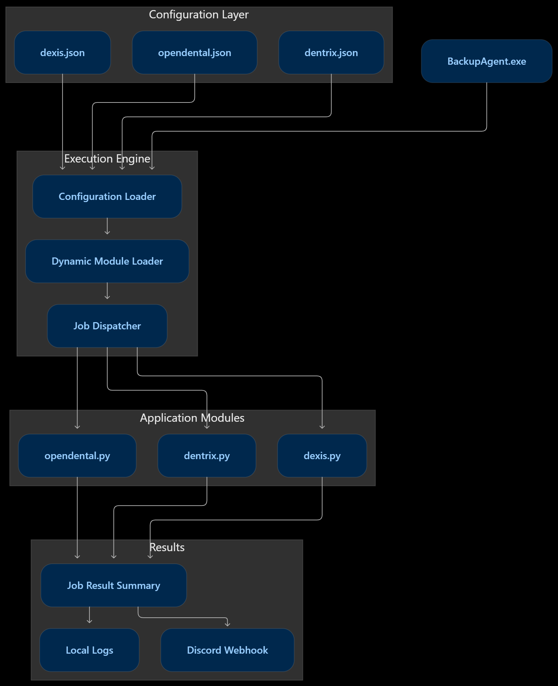
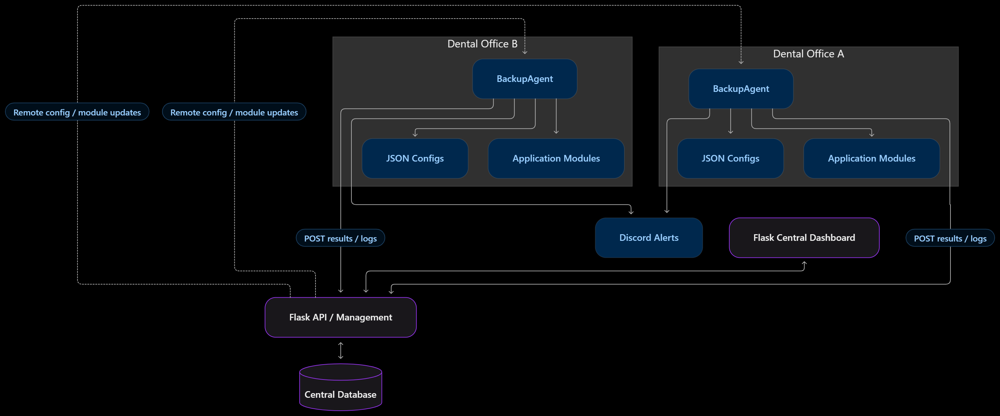

# py-backup-agent

- A modular, configuration-driven backup automation system designed for dental practice applications on Windows.

## Execution Flowchart

## Architechture

## Future Architechture

